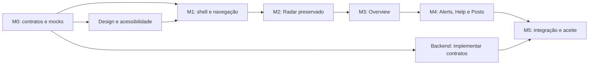

# Plano de entrega contract-first do frontend

Este plano desenvolve o protótipo navegável descrito em [frontend.md](frontend.md) e verifica os cenários de [frontend-aceite.md](frontend-aceite.md). O contrato HTTP é definido e validado antes da integração; adapters permitem implementar as telas contra mocks e trocar cada fonte pela API real. A aceitação das decisões de produto não significa que as novas rotas já existam.

## 0. Suposições declaradas

| ID | Suposição |
|---|---|
| S1 | Stack solicitada: React, TypeScript, Vite, React Router, TanStack Query, MSW, Vitest, Testing Library, Playwright e Storybook. MSW, Testing Library, Playwright e Storybook são adições planejadas. Preservar Tailwind v4, MapLibre e react-map-gl. |
| S2 | Mapa nacional, radar, comparação e história existem; abas e endpoints novos ainda não. Confirmar comportamento no inventário inicial. |
| S3 | Papéis genéricos: Dev Front, Dev Back, Designer, QA e PO; capacidade e prazo não informados. Estimativas são esforço relativo, não datas. |
| S4 | Novos campos e exemplos desta especificação são propostas sintéticas; o backend deve revisar os schemas. As rotas atuais mantêm compatibilidade. |
| S5 | API existente em `/api`, sem novo prefixo de versão presumido. Mudanças incompatíveis exigem versão negociada. |
| S6 | Protótipo público e somente leitura, sem login. `403` informa acesso indisponível, sem criar autenticação. |
| S7 | Paginação opcional por cursor para organizações e posts; default de organizações 20, máximo 100. Limite de posts depende do backend. |
| S8 | Timeout JSON inicial de 15 s; alertas com staleTime e polling de 5 min enquanto visíveis; organizações 24 h e posts 1 h. Ajustar por medição. |
| S9 | ETag, limites numéricos e códigos novos ainda não foram observados. Aceitar operação sem ETag; tratar 429 e Retry-After quando disponíveis. |
| S10 | OpenAPI 3.1 é a fonte planejada; gerar tipos TypeScript e schemas de validação a partir dela. |
| S11 | Fixtures sintéticas são identificadas e restritas a desenvolvimento, teste e demonstração configurada; nunca se apresentam como dados reais em produção. |
| S12 | Objetivo de acessibilidade: WCAG 2.1 AA nos fluxos principais, sujeito a testes e sem alegar certificação. |
| S13 | Extensão opcional de organizações: `reference.kind=pair|pass|state`, `campaignsStatus` e `snapshotDate`; cliente tolera ausência até backend implementar. |
| S14 | Posts automáticos são a opção aceita; posts editoriais, GlobalGiving e GUNW são extensões fora do núcleo. |
| S15 | Janela padrão de radar: 30 dias. Aquisições são dias UTC e alertas são instantes exibidos em UTC. |
| S16 | O site navega apenas por estados; API legada ainda pode aceitar país e macrorregiões. `br` é permitido na consulta nacional de alertas. |
| S17 | JSONs e URLs de exemplo são sintéticos, não avisos oficiais. |

## 1. Visão geral e marcos

Escala por tarefa: P até meio dia; M mais de meio dia até um dia; G mais de um até dois dias de esforço individual. Não inclui espera por revisão nem é prazo de entrega.



| Marco | Entregáveis | Critério de saída | Dependência de backend |
|---|---|---|---|
| M0 | Inventário, OpenAPI, fixtures e adapters | Schema válido, fixtures verificadas e revisão de compatibilidade registrada | Revisão de Dev Back; implementação não bloqueia |
| M1 | Shell, seletor de UF, URL e abas | Deep links, histórico e teclado passam | Nenhuma rota nova |
| M2 | Radar, comparação e história preservados | Seleção, imagens, links e incompatibilidade passam com mocks e serviços existentes | Endpoints atuais para integração real |
| M3 | Overview com seções independentes | Dados, vazios e falhas por bloco verificáveis | Novas fontes podem usar mocks |
| M4 | Alerts, Help e Posts navegáveis | Cenários de cada aba exercitáveis via MSW | Implementação não bloqueia protótipo |
| M5 | Integração seletiva, testes e aceite | Contratos reais validados por feature ou pendências registradas; todos os cenários rastreados | Novas rotas para declarar integração real |

Caminho crítico: M0 → M1 → M2 → M3 → M4 → M5. Backend, design e preparação de testes podem avançar em paralelo após estabilização dos schemas; as abas podem ser divididas entre pessoas depois do shell.

## 2. Tarefas

| ID | Tarefa | Descrição | Depende de | Marco | Responsável | Estimativa | Critério de conclusão | Artefatos |
|---|---|---|---|---|---|---|---|---|
| T1.01 | Inventário | Mapear rotas e comportamento atual | — | M0 | Dev Front | M | Código confrontado com docs | Inventário |
| T1.02 | Fonte de contrato | Configurar OpenAPI e geração de tipos | T1.01 | M0 | Front + Back | G | Schema válido e geração reproduzível | OpenAPI, configuração |
| T1.03 | Contratos atuais | Descrever rotas existentes sem alterar payload | T1.02 | M0 | Dev Back | G | Exemplos atuais validam | Schemas |
| T1.04 | Contratos novos | Definir alerts, organizations e posts | T1.02 | M0 | Dev Back | G | Campos, erros e exemplos revisados | Schemas novos |
| T1.05 | Ferramentas | Configurar MSW, Testing Library, Playwright e Storybook | T1.02 | M0 | Dev Front | G | Smoke de componente e E2E em CI | Configuração |
| T1.06 | Fixtures | Cenários sucesso, vazio, erro, lento, offline e 403 | T1.04, T1.05 | M0 | Dev Front | G | Fixtures validam contra schema | Handlers e fixtures |
| T1.07 | Adapters | Selecionar mock/API por feature | T1.04, T1.05 | M0 | Dev Front | G | Transporte muda sem alterar componente | Adapters e flags |
| T1.08 | Design | Especificar estados, foco e componentes | T1.01 | M0 | Designer | M | Estados revisados | Guia e stories |
| T2.01 | URL | Validar aba, período, dia e passagem; migrar links | T1.03 | M1 | Dev Front | G | Testes de URL e replace passam | Parser e testes |
| T2.02 | Estados | Restringir seletor e rejeitar IDs inválidos | T2.01 | M1 | Dev Front | M | A01 e A02 passam | Rotas e testes |
| T2.03 | Abas | Criar shell com URL e histórico | T2.01, T1.08 | M1 | Dev Front | G | Cinco abas navegáveis por teclado | Componentes |
| T2.04 | Responsividade | Overflow, foco e ordem mobile | T2.03 | M1 | Front + Designer | M | A24 passa nos tamanhos do DoD | Estilos e stories |
| T2.05 | Concorrência | Chaves completas, cancelamento e placeholder seguro | T1.07, T2.03 | M1 | Dev Front | G | Resposta antiga não substitui contexto atual | Hooks e testes |
| T3.01 | Radar | Integrar calendário, filtros, lista e detalhe existentes | T2.03, T2.05 | M2 | Dev Front | G | Seleção restaura após navegação | Radar integrado |
| T3.02 | Mapa e imagens | Reusar camadas e tratar georef e WebGL | T3.01 | M2 | Dev Front | G | A12 e A13 passam | Camadas e testes |
| T3.03 | Comparação e história | Preservar links, aviso e retorno | T3.01 | M2 | Dev Front | M | A11 passa e rotas funcionam | Links e testes |
| T4.01 | Resumo radar | Consumir passes e tratar medianGapDays nulo | T3.01 | M3 | Dev Front | M | A09 passa | Bloco Overview |
| T4.02 | Par destacado | Aplicar janela e desempates documentados | T3.01 | M3 | Dev Front | M | A10 passa | Função e testes |
| T4.03 | Blocos Overview | Alertas, organizações, história e emergência | T1.07, T4.01, T4.02 | M3 | Dev Front | G | Falha de bloco não bloqueia demais | Cards e stories |
| T5.01 | Alerts | `include=recent`, classificação e expiração | T1.06, T2.05 | M4 | Dev Front | G | A14–A18 passam | Aba e testes |
| T5.02 | Selos | Agrupar municípios por IBGE e deduplicar | T5.01 | M4 | Dev Front | M | A16 passa | Agregador e testes |
| T5.03 | Help | Filtros, referência, total e campanhas | T1.06, T2.05 | M4 | Dev Front | G | A21–A23 passam | Aba e testes |
| T5.04 | Posts | Ordenar e seguir links tipados | T1.06, T2.05 | M4 | Dev Front | G | Três tipos levam ao destino correto | Aba e testes |
| T5.05 | Estados comuns | Loading, vazio, erro, stale e retry por fonte | T1.08, T2.05 | M4 | Dev Front | M | A19–A21 passam | Componentes e stories |
| T5.06 | Alertas no backend | Implementar contrato de alerts | T1.04 | M4 | Dev Back | G | Testes de contrato passam | Endpoint e testes |
| T5.07 | Organizações no backend | Implementar contrato de organizations | T1.04 | M4 | Dev Back | G | Testes de contrato passam | Endpoint e testes |
| T5.08 | Posts no backend | Implementar contrato de posts | T1.04 | M4 | Dev Back | G | Testes de contrato passam | Endpoint e testes |
| T6.01 | Unidade | URL, datas, pares, IBGE e referência | T2.01, T4.02, T5.03 | M5 | Dev Front | G | A02–A05, A09–A10, A16–A18 automatizados | Suíte |
| T6.02 | Componentes | Estados, retry e concorrência | T5.05 | M5 | QA + Front | G | A08, A12, A14–A15, A19–A21 automatizados | Suíte |
| T6.03 | E2E | Jornada, histórico, abas e links | T5.04 | M5 | QA | G | A01, A06–A07 e destinos passam | Playwright |
| T6.04 | Acessibilidade | Teclado, zoom, leitor de tela e mobile | T2.04, T5.05 | M5 | QA + Designer | G | Checklist preenchido com evidências | Relatório |
| T6.05 | API real | Virar por feature e executar checklist | T5.06, T5.07, T5.08, T6.02 | M5 | Front + Back | G | Contrato e smoke passam por feature | Registro de integração |
| T6.06 | Documentação | Publicar contrato e registrar aceite | T6.03, T6.04 | M5 | Front + PO | M | Todos os cenários com resultado ou pendência | Guia e relatório |

### Matriz de rastreabilidade

IDs A01–A24 correspondem, em ordem, às linhas de `frontend-aceite.md`; U = unidade, C = componente, E = E2E, M = inspeção manual.

| ID | Cenário | Tarefas | Teste |
|---|---|---|---|
| A01 | Seleção de UF no mapa e lista | T2.02, T6.03 | E01 |
| A02 | País, macrorregião ou UF desconhecida | T2.02, T6.01 | U01, E02 |
| A03 | Link legado com day/pass | T2.01, T6.01 | U02 |
| A04 | Link sem tab, day e pass | T2.01, T6.01 | U03 |
| A05 | Aba ou período inválido | T2.01, T6.01 | U04 |
| A06 | Trocar aba, voltar e recarregar | T2.03, T3.01, T6.03 | E03 |
| A07 | Trocar período ou estado limpa seleção | T2.01, T3.01, T6.03 | E04 |
| A08 | Respostas fora de ordem | T2.05, T6.02 | C01 |
| A09 | medianGapDays nulo | T4.01, T6.01 | U05 |
| A10 | Pares empatados ou inexistentes | T4.02, T6.01 | U06 |
| A11 | Par incompatível | T3.03 | M01 |
| A12 | Georef nulo ou low | T3.02, T6.02 | C02 |
| A13 | Imagem ou WebGL indisponível | T3.02 | M02 |
| A14 | Alertas vazios | T5.01, T6.02 | C03 |
| A15 | INMET indisponível sem bloquear Radar | T5.01, T5.05, T6.02 | C04 |
| A16 | Alerta em duas UFs | T5.02, T6.01 | U07 |
| A17 | Expiração pelo relógio | T5.01, T6.01 | U08 |
| A18 | Virada do dia UTC | T5.01, T6.01 | U09 |
| A19 | Stale ou falha com dados preservados | T5.05, T6.02 | C05 |
| A20 | Placeholder anterior | T2.05, T5.05, T6.02 | C06 |
| A21 | Organizações vazias ou indisponíveis | T5.03, T5.05, T6.02 | C07 |
| A22 | Campanhas vazias sem causa inventada | T5.03 | C08 |
| A23 | Pan/zoom não altera referência | T5.03 | M03 |
| A24 | Teclado e mobile | T2.04, T6.04 | M04 |

## 3. Contratos Front ↔ Back

Os tipos existentes em `web/src/api/types.ts` são a referência para transcrição integral em OpenAPI na T1.03. Exemplos de respostas existentes abaixo são projeções ilustrativas quando indicado; não substituem os schemas completos. Dados novos e sintéticos seguem S4 e S17.

### 3.1 Convenções transversais

| Tema | Contrato |
|---|---|
| Autenticação | Público e somente leitura; 403 não abre login (S6). |
| Base e versão | `/api`; preservar rotas existentes. Mudança incompatível exige versão negociada (S5). |
| Erro | `{ "error": { "code": "invalid_query", "message": "Invalid query.", "issues": [{ "path": "start", "message": "Invalid date." }] } }`; issues opcional. |
| Códigos | 400 `invalid_query`/`window_too_large`; 404 `region_not_found`/`pass_not_found`/`story_not_found`; 403 `forbidden`; 429 `rate_limited`; 5xx `upstream_unavailable`/`internal_error`. Os últimos são propostos (S4, S9). |
| Datas e IDs | Dias UTC `YYYY-MM-DD`, instantes ISO com offset exibidos em UTC; IDs opacos; IBGE como identificador de sete dígitos no contrato novo (S4, S15). |
| Paginação | Cursor opaco e ordenação estável opcional para rotas novas; não aplicar retroativamente (S7). Cursor evita deslocamento quando itens são inseridos. |
| Filtros e ordenação | Parâmetros inválidos retornam 400; desempates por feature são estáveis. |
| Rate limit e timeout | Cliente respeita `Retry-After` em 429; timeout inicial de 15 s (S8–S9). |
| Cache | Chave inclui todos os filtros; `ETag`/`If-None-Match` opcionais. `stale` do servidor não equivale a cache fresco do cliente (S9). |
| Atualização | Polling de alertas enquanto visível; sem realtime no núcleo (S8). |
| Idempotência | GET sem efeitos; não há chave de idempotência. |
| Cancelamento | AbortSignal no cliente; servidor tolera desconexão; troca de contexto não exibe erro de cancelamento. |
| Fontes | JSON externo via API; PNG da ASF diretamente; chave GlobalGiving apenas no servidor. |

### 3.2 Contrato por feature

#### Feature: Navegação e shell

**Objetivo de UX:** selecionar UF e compartilhar/restaurar aba e seleção.

| Campo | Tipo | Obrigatório | Descrição | Exemplo |
|---|---|---|---|---|
| regions | Region[] | Sim | Estados | lista de Region |
| id, name | string | Sim | Sigla e nome oficial | rs, Rio Grande do Sul |
| ibgeCode | number | Não no tipo existente | Código estadual | 43 |
| bbox | [number,number,number,number] | Sim | Oeste, sul, leste, norte | [-57.6,-33.8,-49.7,-27.0] |
| geometria | GeoJSON FeatureCollection | Sim para mapa | Polígonos | FeatureCollection |

| Método | Path | Query params | Request body | Response | Erros |
|---|---|---|---|---|---|
| GET | /api/regions | kind=state | — | `{regions: Region[]}` | 400, 5xx |
| GET | /api/regions/geojson | kind=state | — | GeoJSON | 400, 5xx |
| GET | /api/coverage | start,end | — | CoverageResponse existente | 400, 5xx |

Exemplo sintético de `/regions`:

```json
{"regions":[{"id":"rs","kind":"state","code":"RS","name":"Rio Grande do Sul","ibgeCode":43,"parentId":"sul","bbox":[-57.6,-33.8,-49.7,-27.0]}]}
```

**Estados de UI:** loading com progresso; vazio com mensagem; erro com retry; parcial mantém mapa ou lista funcional; 403 informa acesso indisponível; offline preserva apenas dados da mesma chave com aviso.

**Ações → chamadas:** abrir `/` consulta regiões, geometria e cobertura; escolher estado altera URL e consulta a aba ativa.

**Front:** URL, histórico, seleção e apresentação. **Back:** regiões, geometria e cobertura. Enquadramento é local.

**Não funcionais:** sem paginação para 27 estados; cache longo para limites; sem polling; convenções 3.1.

**Mock/adapter:** `navigationAdapter`, cenários success, empty, error, slow, forbidden e offline; seleção conforme seção 4. **Aceite:** A01–A08, A20, A24. **Prioridade back: NECESSÁRIO**, pois é a entrada e os endpoints existentes precisam permanecer compatíveis.

#### Feature: Radar

**Objetivo de UX:** explorar dias, passagens, contornos, prévias e comparação.

| Campo | Tipo | Obrigatório | Descrição | Exemplo |
|---|---|---|---|---|
| summary | CoverageSummary | Sim | Contagens e datas | medianGapDays=null |
| timeline | TimelineDay[] | Sim | Dias com passagem | date, acquisitions, stacks |
| passes | Pass[] | Sim | Passagens e geometria | ID e stackId |
| dataSource | live\|cache\|stale | Sim | Proveniência | cache |
| georef | Georef\|null | Sim | Cantos da prévia | null |
| quality | good\|low\|string | Com georef | Qualidade; tipo atual admite valores futuros | good |

Direction: `ascending|descending`; maturity: `validated|provisional|beta`. `Pass` completo inclui footprint, bbox, produto, órbita, frequências e URLs; usar schema dos tipos existentes.

| Método | Path | Query params | Request body | Response | Erros |
|---|---|---|---|---|---|
| GET | /api/regions/:id/passes | start,end | — | RegionPassesResponse | 400,404,5xx |
| GET | /api/regions/:id/footprints | start,end | — | GeoJSON | 400,404,5xx |
| GET | /api/passes/:id | — | — | PassResponse | 404,5xx |
| GET | /api/passes/:id/browse | — | — | BrowseInfo | 404,5xx |

Exemplo sintético completo de browse:

```json
{"passId":"synthetic-pass-1","url":"https://example.org/synthetic-browse.png","thumbnail":"https://example.org/synthetic-thumbnail.png","georef":null}
```

**Estados de UI:** loading; vazio no período; erro com retry; parcial mantém lista se imagem ou mapa falhar; 403 e offline explícitos.

**Ações → chamadas:** mudar período consulta passes e footprints; selecionar passagem consulta detalhe e browse; dia filtra localmente.

**Front:** seleção e posição do PNG somente por `georef.corners`; não desenhar com null ou low. **Back:** catálogo, contornos, bbox e georreferenciamento sem prometer precisão não documentada.

**Não funcionais:** até 366 dias por UF; cache existente; sem paginação presumida; PNG direto da ASF; convenções 3.1.

**Mock/adapter:** `radarAdapter`, cenários comuns mais georef-null, georef-low, image-error, out-of-order e webgl-unavailable. **Aceite:** A06–A08, A12–A13, A18, A20. **Prioridade back: NECESSÁRIO**, fluxo central existente.

#### Feature: Overview

**Objetivo de UX:** resumir cobertura e contexto sem sugerir detecção automática.

| Campo | Tipo | Obrigatório | Descrição | Exemplo |
|---|---|---|---|---|
| summary.acquisitions, distinctDates | number | Sim | Passagens e dias | 2 |
| summary.lastDate | string\|null | Sim | Último dia UTC | 2026-11-05 |
| summary.medianGapDays | number\|null | Sim | Intervalo típico | null |
| pairs | Pair[] | Sim | Pares disponíveis | [] |
| summary.active | number | Sim no contrato novo | Alertas ativos | 1 |
| total | number | Sim no contrato novo | Organizações antes do limite | 12 |
| stories | StoryListItem[] | Sim | Histórias | [] |

| Método | Path | Query params | Request body | Response | Erros |
|---|---|---|---|---|---|
| GET | /api/regions/:id/passes | start,end | — | Resposta existente | 400,404,5xx |
| GET | /api/regions/:id/pairs | start,end | — | dataSource,region,query,count,pairs | 400,404,5xx |
| GET | /api/regions/:id/alerts | include=active | — | AlertsResponse | 400,403,5xx |
| GET | /api/regions/:id/organizations | areas,near,limit=3 | — | OrganizationsResponse | 400,403,5xx |
| GET | /api/stories | — | — | StoriesResponse | 5xx |

Exemplo sintético de pares sem resultados:

```json
{"dataSource":"cache","region":{"id":"rs","kind":"state","code":"RS","name":"Rio Grande do Sul","ibgeCode":43,"parentId":"sul","bbox":[-57.6,-33.8,-49.7,-27.0]},"query":{"start":"2026-11-01","end":"2026-11-14","product":"GCOV","eventDate":null,"mode":"consecutive"},"count":0,"pairs":[]}
```

**Estados de UI:** loading, vazio, erro e retry por bloco; 403/offline de uma fonte não bloqueia as outras; stale identificado junto ao conteúdo.

**Ações → chamadas:** abrir consulta fontes independentes; comparação e história abrem destinos próprios; abas reutilizam cache quando as chaves coincidem.

**Front:** ordenar pares por after.date e before.date decrescentes e stackId, before.id e after.id crescentes; calcular centro aproximado de bbox; mostrar contatos fixos. **Back:** devolver dados e pares compatíveis; não há endpoint agregado obrigatório.

**Não funcionais:** até 366 dias; sem polling próprio; alertas seguem sua política. **Mock/adapter:** composição de adapters; cenários comuns, null-gap, pair-tie, no-pair e falha independente. **Aceite:** A09–A10, A15, A19, A21. **Prioridade back: NECESSÁRIO**, compõe a entrada estadual.

#### Feature: Alerts

**Objetivo de UX:** avisos oficiais atuais e vencidos recentes, sem inferir inundação detectada.

| Campo | Tipo | Obrigatório | Descrição | Exemplo |
|---|---|---|---|---|
| dataSource | live\|cache\|stale | Sim | Estado da fonte | live |
| updatedAt | string ISO\|null | Sim, nullable proposto S4 | Última atualização conhecida | 2026-11-14T15:30:00Z |
| summary.active | number | Sim | Quantidade ativa | 1 |
| summary.highestSeverity | minor\|moderate\|severe\|extreme\|null | Sim | Maior severidade ativa | moderate |
| alerts | Alert[] | Sim | Avisos | [] |
| severity | minor\|moderate\|severe\|extreme | Sim | Severidade | moderate |
| status | active\|expired | Sim | Estado no retorno | active |
| municipalities[].code | string | Sim no schema novo S4 | Código IBGE | 4314902 |
| geometry | Polygon\|null | Sim, nullable proposto S4 | GeoJSON | null |

| Método | Path | Query params | Request body | Response | Erros |
|---|---|---|---|---|---|
| GET | /api/regions/:id/alerts | include=active\|recent; default active | — | AlertsResponse | 400,403,404,429,5xx |

`id` aceita UF ou br; macrorregião retorna 400. Recent inclui ativos e vencidos há até 48 h; UF filtra municípios, br contém todos. Backend deduplica por ID.

```json
{"dataSource":"live","region":{"id":"rs","name":"Rio Grande do Sul"},"updatedAt":"2026-11-14T15:30:00Z","summary":{"active":1,"highestSeverity":"moderate"},"alerts":[{"id":"synthetic-alert-1","event":"Tempestade fictícia","severity":"moderate","color":"#FFFE00","onset":"2026-11-14T11:37:00Z","expires":"2026-11-15T02:59:00Z","status":"active","headline":"Aviso sintético para teste","description":"Descrição sintética; não é aviso oficial.","instruction":"Instrução sintética; não é orientação oficial.","url":"https://example.org/synthetic-alert","municipalities":[{"code":"4314902","name":"Porto Alegre"}],"municipalityCountTotal":1,"geometry":null}]}
```

**Estados de UI:** loading; vazio apenas após sucesso; erro e 403 indicam que não foi possível verificar; parcial/stale identifica dados preservados; offline não afirma ausência; retry local.

**Ações → chamadas:** aba solicita recent, Overview e selos active; retry repete a chave. Expiração local não comprova ausência de novos avisos.

**Front:** ordenar por severidade, início e ID; vencidos por expiração e ID; agregar por IBGE; preservar texto e indicar UTC. **Back:** normalizar CAP, filtrar UF, manter textos, converter geometria para [lon,lat], fornecer status e frescor.

**Não funcionais:** polling e cache S8; paginação não necessária no núcleo; 429 conforme 3.1. **Mock/adapter:** `alertsAdapter`, cenários comuns, stale, two-states, expires-soon, expired e overlap. **Aceite:** A14–A19. **Prioridade back: NECESSÁRIO**, habilita feed, resumo e selos.

#### Feature: Organizações / Help

**Objetivo de UX:** apresentar organizações próximas sem sugerir endosso ou disponibilidade.

| Campo | Tipo | Obrigatório | Descrição | Exemplo |
|---|---|---|---|---|
| reference | objeto | Sim | Coordenadas para ordenação | lon,lat,kind |
| reference.kind | pair\|pass\|state | Sim na extensão S13 | Origem | state |
| total | number | Sim | Total antes do limite | 12 |
| organizations | array | Sim | Itens | [] |
| distanceKm | number | Sim | Distância à referência | 1.8 |
| snapshotDate | string\|null | Opcional S13 | Data da base | 2026-10-01 |
| campaignsStatus | available\|not_configured\|unavailable | Opcional S13 | Disponibilidade de campanhas | not_configured |
| nextCursor | string\|null | Opcional S7 | Próxima página | null |

| Método | Path | Query params | Request body | Response | Erros |
|---|---|---|---|---|---|
| GET | /api/regions/:id/organizations | areas,near,limit,cursor opcional | — | OrganizationsResponse | 400,403,404,429,5xx |

Default de areas `5,1,2,12`, near `lon,lat`, limit 20, máximo 100; total anterior à paginação.

```json
{"region":{"id":"rs","name":"Rio Grande do Sul"},"reference":{"lon":-51.22,"lat":-30.03,"kind":"state"},"total":1,"organizations":[{"id":1425406,"name":"Organização fictícia","areas":["Assistência social"],"municipality":{"code":"4314902","name":"Porto Alegre"},"lon":-51.21,"lat":-30.04,"distanceKm":1.8,"url":"https://example.org/organization/1425406"}],"campaigns":[],"campaignsStatus":"not_configured","snapshotDate":null,"nextCursor":null,"notice":"Being listed is not an endorsement. Source: Mapa das OSCs (IPEA)."}
```

**Estados de UI:** loading, vazio com filtros, erro com retry, parcial quando contrato distinguir campanhas, 403 e offline explícitos. Sem campaignsStatus e com campaigns vazias, ocultar seção sem inferir causa.

**Ações → chamadas:** mudar áreas ou referência consulta novamente; carregar mais usa cursor quando disponível; pan e zoom não alteram near.

**Front:** selecionar origem da referência e calcular centro de bbox. **Back:** filtrar situação e áreas, ordenar por distância, fornecer total, snapshot conhecido e paginação estável. Distância não mede capacidade ou atendimento.

**Não funcionais:** cursor S7, cache S8, sem polling ou chamada por município. **Mock/adapter:** `organizationsAdapter`, cenários comuns, empty-filter, campaigns-unknown, campaigns-unavailable, snapshot-unknown e duas páginas. **Aceite:** A21–A23. **Prioridade back: NECESSÁRIO**; campanhas são FUTURO.

#### Feature: Posts

**Objetivo de UX:** publicações automáticas factuais com links tipados.

| Campo | Tipo | Obrigatório | Descrição | Exemplo |
|---|---|---|---|---|
| dataSource | live\|cache\|stale | Sim | Proveniência | cache |
| id | string | Sim | ID estável | pass-day:rs:2026-11-05 |
| kind | pass\|pair\|story | Sim | Tipo | pass |
| date | string | Sim | Dia UTC | 2026-11-05 |
| title,text | string | Sim | Texto factual | NISAR passed over Rio Grande do Sul |
| link.page | region\|compare\|story | Sim | Destino | region |
| nextCursor | string\|null | Opcional S7 | Próxima página | null |

| Método | Path | Query params | Request body | Response | Erros |
|---|---|---|---|---|---|
| GET | /api/regions/:id/posts | start,end,limit,cursor opcionais S7 | — | PostsResponse | 400,403,404,429,5xx |

Limites de posts ainda dependem do backend.

```json
{"dataSource":"cache","region":{"id":"rs","name":"Rio Grande do Sul"},"posts":[{"id":"pass-day:rs:2026-11-05","kind":"pass","date":"2026-11-05","title":"NISAR passed over Rio Grande do Sul","text":"A synthetic pass is available for this day.","link":{"page":"region","regionId":"rs","tab":"radar","day":"2026-11-05"}}],"nextCursor":null}
```

Variantes: region contém regionId, tab=radar e day; compare contém before e after; story contém storyId.

**Estados de UI:** loading, vazio, erro/retry, stale, 403 e offline; não apresentar dados anteriores como pertencentes a outra UF.

**Ações → chamadas:** abrir aba consulta período; item navega por link; carregar mais usa cursor se suportado.

**Front:** renderizar, validar destino e ordenar data decrescente, kind e ID crescentes. **Back:** gerar fatos, IDs estáveis e ordenação compatível, sem afirmações de desastre sem fonte.

**Não funcionais:** cursor opcional S7, cache de uma hora S8, sem realtime. **Mock/adapter:** `postsAdapter`, cenários comuns, all-kinds, same-date, empty-window e paginação. **Aceite:** links em T5.04/T6.03, estados A19–A20. **Prioridade back: NECESSÁRIO**, uma das cinco abas.

#### Feature: Comparação e história

**Objetivo de UX:** comparar passagens ou explorar história com fontes e retorno à exploração.

| Campo | Tipo | Obrigatório | Descrição | Exemplo |
|---|---|---|---|---|
| before,after | Pass | Sim no par | Passagens | IDs opacos |
| stackId | string | Sim | Geometria compatível | 053_D_103 |
| stories | StoryListItem[] | Sim | Histórias | [] |
| narrative | objeto | Sim em história | Texto e ressalvas | summary,caveats |
| sources | array | Sim | Atribuições | title,publisher,url |

| Método | Path | Query params | Request body | Response | Erros |
|---|---|---|---|---|---|
| GET | /api/regions/:id/pairs | start,end,eventDate opcional | — | RegionPairsResponse | 400,404,5xx |
| GET | /api/passes/:id e /browse | — | — | Contratos existentes | 404,5xx |
| GET | /api/stories e /api/stories/:id | — | — | Lista e história existentes | 404,5xx |

Exemplo sintético completo de lista vazia: `{"stories":[]}`. Schema integral de história vem de `Story` em `web/src/api/types.ts`.

**Estados de UI:** loading, vazio, erro/retry, parcial mantém narrativa se imagem falhar, 403 e offline identificados; incompatibilidade recebe aviso.

**Ações → chamadas:** comparação consulta duas passagens e prévias; história consulta ID; retorno usa rota regional ou histórico seguro.

**Front:** verificar stackId, avisar incompatibilidade e manter Space/B/A fora de campos editáveis. **Back:** fornecer passagens, pares, narrativa e fontes.

**Não funcionais:** cache existente; paginação e realtime não presumidos. **Mock/adapter:** storiesAdapter e radarAdapter; cenários comuns, incompatible-pair, missing-image e story-not-found. **Aceite:** A11–A13 e links T6.03. **Prioridade back: NECESSÁRIO**, fluxos existentes sem regressão.

## 4. Estratégia de mock e contract testing

1. OpenAPI 3.1 versionada é a fonte normativa; gerar tipos e schemas dela. Comparar com tipos atuais antes da migração. Validar schema, geração sem diff e fixtures em CI.
2. MSW intercepta as mesmas URLs dos adapters. Cada feature tem success, empty, error, slow, forbidden e offline, além dos casos específicos acima. Selecionar cenário por configuração de desenvolvimento/teste e por parâmetros controlados de Playwright.
3. Flags propostas `VITE_DATA_SOURCE_SHELL`, `VITE_DATA_SOURCE_RADAR`, `VITE_DATA_SOURCE_ALERTS`, `VITE_DATA_SOURCE_ORGANIZATIONS` e `VITE_DATA_SOURCE_POSTS`, valores `mock|api`. Build de produção real deve rejeitar mocks ativos indevidamente (S11).
4. Executar mesmos schemas e exemplos contra ambiente de teste do backend, incluindo erros, nulls, enums e campos opcionais. Checklist: base URL, CORS, erros, UTC, cancelamento, paginação, ordenação, frescor, atribuição, 403/429, vazios e campanhas.

| Ordem | Feature | Flag | Critério de virada | Rollback |
|---|---|---|---|---|
| 1 | Shell | SHELL=api | Regiões, geometria e cobertura passam no schema e smoke | Mock apenas em demonstração identificada |
| 2 | Radar | RADAR=api | Passes, footprints, browse e pares validados | Mock apenas em teste |
| 3 | Alerts | ALERTS=api | active/recent, br, stale e expiração verificados | Produção mostra indisponibilidade; nunca dados fictícios |
| 4 | Organizations | ORGANIZATIONS=api | Filtros, distância, total e metadados validados | Mock apenas em teste |
| 5 | Posts | POSTS=api | Três links e ordenação validados | Mock apenas em teste |

As flags da tabela usam o prefixo `VITE_DATA_SOURCE_`. Como Vite as incorpora no build, a reversão pode exigir novo build.

## 5. Riscos, dependências e contingência

| Dependência | Necessária até | Contingência |
|---|---|---|
| Revisão de schemas pelo backend | Saída M0 | Usar fixtures versionadas e registrar divergências; não declarar contrato acordado |
| API atual de regiões e radar | M2 para integração real | Usar MSW e reservar smoke real |
| Alerts e agregação br | M5 para integração real | Demonstrar dados sintéticos identificados; produção mostra indisponibilidade |
| Snapshot filtrado de organizações | M5 para Help real | Fixture em demonstração; não publicar lista fictícia |
| Posts automáticos | M5 para Posts real | Mock em demonstração; aba indisponível em produção |

| Risco | Probabilidade | Impacto | Mitigação | Gatilho |
|---|---|---|---|---|
| Contrato muda após consumo | Média | Alto | Versionar schema, testes de compatibilidade e revisão conjunta | Payload real falha no CI: suspender virada |
| INMET incompleto ou indisponível | Média | Alto | Stale e falha explícitos | Campos obrigatórios não fornecidos |
| Base IPEA sem áreas ou snapshot | Média | Alto | Metadados de origem e pendência | Filtros aprovados não podem ser aplicados |
| Georef de imagem indisponível | Média | Alto | Não desenhar null/low; manter detalhes | Resposta sem georef utilizável |
| PNGs pesados e mapa | Média | Médio | Reuso e carregamento sob demanda | Downloads duplicados ou navegação degradada em medição |
| Relógio local incorreto | Média | Médio | Não afirmar ausência de novos alertas | Expiração local diverge da resposta atualizada |
| Cursor instável | Média | Médio | Ordenação e testes de inserção | Item duplicado ou omitido |
| Capacidade desconhecida | Média | Médio | Introduzir ferramentas incrementalmente | Setup supera capacidade; priorizar contrato e fluxo crítico |

Mudanças incompatíveis exigem proposta registrada, revisão dos consumidores e versão ou período de compatibilidade. Alterações aditivas exigem consumidores tolerantes a campos desconhecidos.

## 6. Definição de pronto

- [ ] Mapa nacional, seleção de UF e cinco abas navegáveis.
- [ ] Links legados e novos, histórico e recarga verificados.
- [ ] Radar, comparação e história preservados; incompatibilidade e falha de imagem tratadas.
- [ ] Cada aba cobre loading, vazio, erro, parcial, 403 e offline.
- [ ] Fixtures identificadas; produção não as apresenta como dados reais.
- [ ] Testes unitários de URL, pares, datas, IBGE e proximidade passam.
- [ ] Componentes cobrem estados, retry, foco e respostas fora de ordem.
- [ ] Playwright cobre jornada nacional, abas, histórico, Radar e links de Posts.
- [ ] Contratos e fixtures validados; integração real identificada por feature.
- [ ] Fluxos principais verificados contra objetivo WCAG 2.1 AA com teclado, foco, contraste, leitor de tela, zoom e movimento reduzido; limitações registradas.
- [ ] Layout verificado em 320 px, largura intermediária e desktop desde 1024 px, incluindo 1280×720.
- [ ] OpenAPI, mocks, flags e checklist publicados.
- [ ] A01–A24 têm teste ou inspeção e resultado registrado.
- [ ] Dependências pendentes de backend estão explícitas; mock não é declarado integração real.

## 7. Suposições e perguntas abertas

| ID | Suposição/pergunta | Impacto se errada | Quem responde | Como muda o plano |
|---|---|---|---|---|
| S1 | Ferramentas adicionais serão adotadas? | Setup e CI mudam | Tech lead | Substituir ferramentas preservando cenários |
| S2 | Código corresponde ao estado observado? | Trabalho duplicado ou regressões | Dev Front | Atualizar inventário e testes |
| S3 | Qual a capacidade de cada papel? | Duração e paralelismo mudam | PO/tech lead | Replanejar marcos |
| S4 | Backend aceita campos, nulabilidade e códigos propostos? | Adapters divergem | Dev Back | Revisar OpenAPI antes da integração |
| S5 | Como versionar quebras? | Clientes podem quebrar | Dev Back | Definir estratégia de versão |
| S6 | Há restrições reais de acesso? | 403 pode ser insuficiente | PO/Dev Back | Especificar autenticação se necessária |
| S7 | Cursor estável é viável? | Itens podem duplicar ou faltar | Dev Back | Adiar paginação e limitar escopo |
| S8 | Timeouts e intervalos são sustentáveis? | Carga ou dados desatualizados | Dev Back/operação | Ajustar após medição |
| S9 | Haverá ETag e Retry-After? | Estratégia de rede muda | Dev Back/operação | Atualizar contrato e testes |
| S10 | Qual gerador será mantido? | CI e ergonomia mudam | Front + Back | Ajustar T1.02 |
| S11 | Como separar demonstração e produção? | Dados fictícios podem parecer reais | Front/operação | Definir ambientes e bloqueio de build |
| S12 | Qual avaliação de acessibilidade está disponível? | Cobertura de evidências varia | QA/Designer | Ajustar inspeção e registrar limitações |
| S13 | Como representar referência de passagem e falha parcial? | Help pode inferir causa incorreta | Dev Back | Manter fallback até extensão existir |
| S14 | Conteúdo editorial ou campanhas entram depois? | Amplia modelo e testes | PO | Marco separado |
| S15 | Janela padrão e UTC permanecem adequados? | Datas e links mudam | PO/Front | Revisar parser e A18 |
| S16 | API legada de país/macrorregião precisa de suporte duradouro? | Outros clientes podem quebrar | Dev Back | Manter compatibilidade e testes |
| S17 | Como identificar fixtures na demonstração? | Confusão com dados reais | PO/QA | Definir marcação visual e publicação |

## 8. Resumo executivo

Ordem: contratos e fixtures; shell e navegação; Radar preservado; Overview; Alerts, Help e Posts; integração real e aceite. Backend pode trabalhar em paralelo após revisão dos schemas. Mocks identificados permitem demonstrar o protótipo enquanto os serviços não estão prontos.

Os cinco contratos necessários, em ordem: (1) regiões, geometria e cobertura para entrada nacional; (2) passagens, footprints e browse para Radar; (3) pares e histórias para Overview e comparação; (4) alertas por UF e br para feed, resumo e selos; (5) organizações e posts para completar Help e Posts, que podem ser desenvolvidos em paralelo.

Riscos principais: mudanças de contrato, disponibilidade das fontes, filtros da base de organizações, georreferenciamento e capacidade desconhecida da equipe. Frontend e backend precisam acordar nulabilidade, paginação, origem dos dados e falhas parciais antes de declarar integração real.
